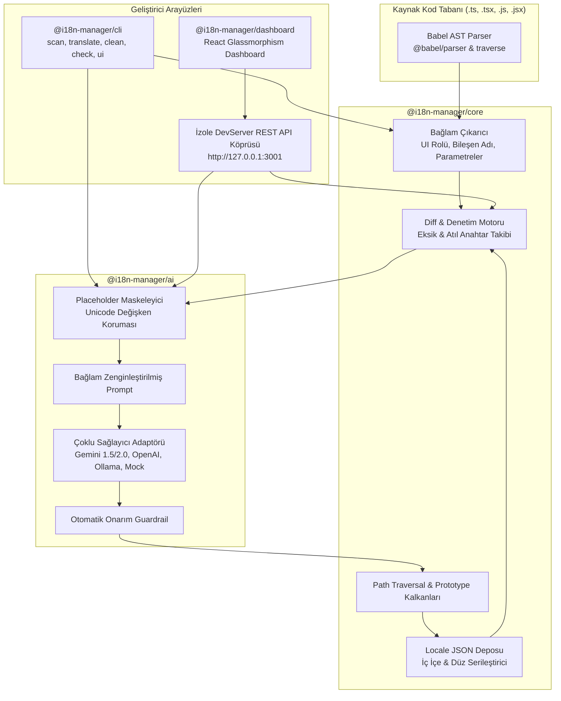

<div align="center">
  <h1>🌐 Autonomous i18n & Localization Manager</h1>
  <p><strong>Geliştiriciler İçin Kod Zekalı, Bağlam Duyarlı Otonom Yazılım Yerelleştirme Motoru</strong></p>

  <p align="center">
    <a href="README.md">English</a> • <strong>Türkçe</strong>
  </p>

[](https://www.typescriptlang.org/)
[](https://nodejs.org/)
[](https://vitest.dev/)
[](#-güvenlik-mimarisi--koruma-kalkanları)
[](LICENSE)

</div>

---

## 📑 İçindekiler Tablosu

- [Yönetici Özeti](#-yönetici-özeti)
- [Sistem Mimarisi](#️-sistem-mimarisi)
- [Monorepo Paket Yapısı](#-monorepo-paket-yapısı)
- [Teknik İnovasyonlar & Temel Direkler](#-teknik-i̇novasyonlar--temel-direkler)
- [Güvenlik Mimarisi & Koruma Kalkanları](#-güvenlik-mimarisi--koruma-kalkanları)
- [Hızlı Başlangıç Kılavuzu](#-hızlı-başlangıç-kılavuzu)
- [Konfigürasyon Referansı](#️-konfigürasyon-referansı)
- [CLI Komut Referansı & Canlı DX](#-cli-komut-referansı--canlı-dx)
- [Web Yönetim Kokpiti](#-web-yönetim-kokpiti)
- [CI/CD GitHub Action Entegrasyonu](#-cicd-github-action-entegrasyonu)
- [Doğrulama & Otomatik Test Paketi](#-doğrulama--otomatik-test-paketi)
- [Yazar & Mimari Notu](#-yazar--mimari-notu)
- [Lisans & Mülkiyet](#-lisans--mülkiyet)

---

## 📌 Yönetici Özeti

**Autonomous i18n Manager**, modern yazılım projelerindeki yerelleştirme (i18n / localization) operasyonlarının getirdiği hantallığı ve hataları tamamen ortadan kaldırmak için geliştirilmiş kurumsal seviyede bir Geliştirici Aracıdır (DevTool).

Geleneksel yerelleştirme süreçleri manuel, dağınık ve insan hatasına son derece açıktır. İlkel regex arama scriptleri veya bağlamdan kopuk makine çevirileri; kod değişkenlerini (`{count}`, `{{userName}}`, `%s`) sıklıkla bozar, UI bağlamından uzak çeviriler üretir ve kullanılmayan eski anahtarları dosyalarda çöp olarak bırakır.

Bu proje; **Soyut Sözdizimi Ağacı (AST) derleyici analizi**, **UI Rol Çıkarımı** ve **LLM Değişken Koruma Kalkanları** kullanarak eksik çeviri anahtarlarını %100 parametre bütünlüğüyle tespit eden, denetleyen ve otonom çeviren modern bir boru hattı sunar.

Hem yerel geliştirici deneyimi (DX) ve CI/CD otomasyonu için ergonomik bir **CLI Motoru**, hem de güvenli bir REST API köprüsüyle beslenen modern **Glassmorphic Web Kokpiti** içerir.

---

## 🏗️ Sistem Mimarisi



---

## 📦 Monorepo Paket Yapısı

Sorumlulukların kesin sınırlarla ayrıldığı (Separation of Concerns), %100 tip güvenli bir TypeScript monorepo mimarisi:

| Paket | Görev | Temel Teknolojiler |
| :--- | :--- | :--- |
| **[`@i18n-manager/core`](packages/core)** | AST derleme motoru, JSON serileştiriciler, diff metrikleri ve güvenlik kalkanları | `@babel/parser`, `@babel/traverse`, `zod` |
| **[`@i18n-manager/ai`](packages/ai)** | Çoklu LLM hattı, değişken token maskeleme, sezgisel otomatik onarım | Google Gemini, OpenAI, Ollama, Fetch API |
| **[`@i18n-manager/cli`](packages/cli)** | İnteraktif terminal arayüzü, tablo formatlama, sihirbaz, CI/CD çıkış kodları | `commander`, `@clack/prompts`, `cli-table3`, `picocolors` |
| **[`@i18n-manager/dashboard`](packages/dashboard)** | Görsel yönetim kokpiti, sağlık radarı, çift tık hücre düzenleme matrisi | React 19, Vite, Lucide Icons, Vanilla CSS |

---

## ✨ Teknik İnovasyonlar & Temel Direkler

### 1. Soyut Sözdizimi Ağacı (AST) Derleyici Zekası
- TypeScript (`.ts`), TSX, JavaScript (`.js`) ve JSX dosyalarını Babel derleyici altyapısıyla statik analize tabi tutar.
- `t('key')`, `i18n.t('key')`, `formatMessage({ id: 'key' })` ve `<Trans i18nKey="..." />` çağrılarını kaynak koddan çıkartır.
- **UI Rol Çıkarımı:** Çevrilecek metnin etrafındaki JSX elemanını (`button`, `heading`, `placeholder`, `error`, `alert`, `aria`) tespit eder. Örneğin bir butondaki "Save" ifadesini isim değil, emir kipi eylemi ("Kaydet") olarak çevirmesini sağlar.

### 2. Değişken Koruma Kalkanı (Variable Shielding)
- **Unicode Token Maskeleme:** Dinamik değişkenleri (`{count}`, `{{userName}}`, `%s`, `<0>etiket</0>`) LLM'e göndermeden önce nötr slot token'larıyla (`__SLOT_0__`) maskeler.
- **Sezgisel Otomatik Onarım:** Yapay zeka dönüşünde çıktıları denetler; kaybolan veya yeri değişen parametreleri otomatik olarak tespit edip onararak çalışma zamanı (runtime) çökmelerini engeller.

### 3. Çoklu LLM Sağlayıcı Orkestrasyonu
- **Google Gemini (1.5 / 2.0 Flash)**, **OpenAI (GPT-4o / GPT-4o-mini)**, **Ollama** (çevrimdışı yerel çıkarım) ve sıfır bağımlılıklı **Mock Sağlayıcı** desteği.
- Akıllı gruplama (batching) mimarisiyle token maliyetini ve istek sayısını minimize eder.

---

## 🛡️ Güvenlik Mimarisi & Koruma Kalkanları

Tüm sistemde kurumsal güvenlik öncelikli bir mühendislik standardı olarak kurgulanmıştır:

### 1. Prototype Pollution Bağışıklığı
- [`@i18n-manager/core`](packages/core/src/store/json-utils.ts) içindeki JSON unflatten ve flatten algoritmaları tehlikeli nesne özelliklerini (`__proto__`, `constructor`, `prototype`) kesin olarak filtreler.
- Global nesne manipülasyonunu ve Uzaktan Kod Yürütme (RCE) açıklarını engeller.

### 2. Path Traversal Güvenlik Duvarı
- [`LocaleStore`](packages/core/src/store/locale-store.ts) sınıfı, dil kodlarında katı bir regex (`/^[a-zA-Z0-9_-]+$/`) zorunlu kılar.
- Çözümlenen dosya yollarının `basePath` dizini dışına çıkamadığı (`path.resolve`) güvenlik istisnalarıyla doğrulanır (`../../etc/passwd` saldırılarına karşı tam koruma).

### 3. İzole Localhost DevServer Köprüsü
- Yerel HTTP sunucusu yalnızca **`127.0.0.1`** (loopback) arabirimine bağlanır; yerel ağdaki veya ortak Wi-Fi'daki diğer cihazlardan erişilemez.
- **CORS Origin Guard:** Çapraz kaynak isteklerini sadece yerel kökenlerle (`localhost` / `127.0.0.1`) sınırlandırarak DNS Rebinding ve CSRF saldırılarını engeller.
- **1MB DoS Kalkanı:** Tüm uç noktalarda 1MB'lık `MAX_BODY_SIZE` sınırı uygular; bellek tüketme (OOM) saldırılarını reddeder.

### 4. Kimlik Bilgisi Koruma İlkesi
- Google Gemini API istekleri, API anahtarını URL sorgu parametresinde ifşa etmek yerine standart `x-goog-api-key` başlığında iletir.
- `.gitignore` kuralları `.env` dosyalarını ve gizli anahtarları otomatik olarak dışlar.

---

## 🚀 Hızlı Başlangıç Kılavuzu

### 1. Klonlama ve Kurulum

```bash
# Depoyu klonlayın
git clone https://github.com/emirergn12/autonomous-i18n.git
cd autonomous-i18n

# Bağımlılıkları kurun ve derleyin
npm install
npm run build
```

### 2. Bir Projede Başlatma

Herhangi bir React, Next.js veya Vue projesi içinde:

```bash
npx @i18n-manager/cli init
```

İnteraktif kurulum sihirbazı kaynak dil, hedef diller ve dosya desenlerini sorarak geçerli bir `i18n.config.json` oluşturur.

---

## ⚙️ Konfigürasyon Referansı

Yapılandırma projenin kök dizinindeki `i18n.config.json` dosyasında tutulur:

```json
{
  "sourceLocale": "en",
  "targetLocales": ["tr", "de", "es", "fr"],
  "localesDir": "./locales",
  "format": "nested-json",
  "include": ["src/**/*.{ts,tsx,js,jsx}"],
  "exclude": ["node_modules/**", "dist/**", "**/*.test.*"],
  "ai": {
    "provider": "gemini",
    "model": "gemini-1.5-flash",
    "temperature": 0.2
  }
}
```

| Özellik | Tip | Açıklama |
| :--- | :--- | :--- |
| `sourceLocale` | `string` | Ana kaynak dil kodu (örn: `'en'`). |
| `targetLocales` | `string[]` | Üretilecek hedef dillerin listesi. |
| `localesDir` | `string` | Dil `.json` dosyalarının bulunduğu dizin. |
| `format` | `'nested-json' \| 'flat-json'` | Dil anahtarlarının saklanma formatı. |
| `include` | `string[]` | Taranacak kaynak dosyaların glob desenleri. |
| `ai.provider` | `'gemini' \| 'openai' \| 'ollama'` | Aktif yapay zeka çeviri sağlayıcısı. |

---

## 🛠️ CLI Komut Referansı & Canlı DX

### Komut Özeti

| Komut | Açıklama | Yaygın Parametreler |
| :--- | :--- | :--- |
| `i18n init` | İnteraktif yapılandırma sihirbazını başlatır. | Yok |
| `i18n scan` | Kod tabanı AST'sini dil dosyalarıyla karşılaştırıp denetler. | `--json` |
| `i18n translate` | Eksik anahtarları LLM ile otonom olarak çevirir. | `--auto-approve`, `--interactive`, `--provider <name>` |
| `i18n clean` | Kodda kullanılmayan atıl anahtarları dil dosyalarından siler. | `-f, --force`, `--dry-run` |
| `i18n check` | CI/CD denetim modu. Eksik anahtar varsa derlemeyi kırar (`exit 1`). | `--cwd <dizin>`, `--format <console\|markdown\|json>`, `-o <dosya>` |
| `i18n ui` | Yerel REST API Köprüsünü ve Web Kokpitini başlatır. | `-p, --port <3000>` |

### Canlı CLI Terminal Çıktısı

```text
$ npx @i18n-manager/cli scan

🔍 [i18n-manager] Codebase Localization Audit
   Source: en | Targets: tr, de, es
   Scanned: 24 file(s) | Keys Extracted: 48

┌────────────┬──────────────────┬────────────────┬───────────────┐
│ Locale     │ Coverage         │ Missing Keys   │ Status        │
├────────────┼──────────────────┼────────────────┼───────────────┤
│ TR         │ 95.8%            │ 2              │ 🟨 Review     │
│ DE         │ 91.6%            │ 4              │ 🟨 Review     │
│ ES         │ 100.0%           │ 0              │ 🟩 Complete   │
└────────────┴──────────────────┴────────────────┴───────────────┘

📊 Overall Health Score: 95.8%

⚠️  Missing Keys (6):
   - [tr] auth.forgot_password [src/components/LoginForm.tsx:42] (Role: button)
   - [tr] dashboard.greeting [src/pages/Dashboard.tsx:18] (Params: {userName})
```

---

## 🖥️ Web Yönetim Kokpiti

Görsel yönetim arayüzünü başlatmak için:

```bash
npx @i18n-manager/cli ui
```

Ardından tarayıcınızda **`http://localhost:3001`** adresine gidin:

- **Sağlık Radarı:** Dinamik renk geçişli gerçek zamanlı yerelleştirme kapsam skoru.
- **İnteraktif Matris Tablosu:** Eksik/atıl anahtarları filtreleyin, hücrelere **çift tıklayarak anında düzenleyin** ve diske kaydedin.
- **AI Çeviri Stüdyosu:** Değişken koruma geri bildirimleriyle yan yana çeviri diff inceleme penceresi.
- **Atıl Anahtar Temizleyici:** Kodda artık bulunmayan eski anahtarları tek tıkla silme.

---

## 🤖 CI/CD GitHub Action Entegrasyonu

Eksik çevrilmiş kodların ana dala birleşmesini engellemek için `.github/workflows/i18n-check.yml` dosyasını ekleyin:

```yaml
name: i18n Localization Audit

on:
  pull_request:
    branches: [main, master]

jobs:
  audit-localization:
    runs-on: ubuntu-latest
    steps:
      - name: Checkout Codebase
        uses: actions/checkout@v4

      - name: Setup Node.js
        uses: actions/setup-node@v4
        with:
          node-version: 20
          cache: 'npm'

      - name: Install Dependencies
        run: npm ci

      - name: Run Localization Audit Check
        run: npx @i18n-manager/cli check --format markdown -o ./i18n-report.md
```

---

## 🧪 Doğrulama & Otomatik Test Paketi

Monorepo genelinde tam tip denetimi ve otomatik regresyon testleri uygulanmaktadır:

```bash
# Tüm test paketini çalıştır
npm test
```

```text
 ✓ packages/ai/tests/prompt.test.ts (2 tests)
 ✓ packages/ai/tests/guardrails.test.ts (5 tests)
 ✓ packages/ai/tests/pipeline.test.ts (1 test)
 ✓ packages/cli/tests/cli.test.ts (4 tests)
 ✓ packages/core/tests/diff-engine.test.ts (1 test)
 ✓ packages/core/tests/config.test.ts (4 tests)
 ✓ packages/core/tests/store.test.ts (7 tests)
 ✓ packages/core/tests/extractor.test.ts (6 tests)
 ✓ packages/core/tests/server.test.ts (5 tests)

 Test Files  9 passed (9)
      Tests  35 passed (35)
   Duration  1.30s
```

---

## 👨‍💻 Yazar & Mimari Notu

Full-stack sistem mimarisi, AST derleyici mühendisliği, güvenli DevServer köprülemesi ve LLM guardrail boru hatlarını sergileyen bir vitrin Geliştirici Aracı & Micro-SaaS projesi olarak tasarlanmış ve geliştirilmiştir.

- **Yazar & Sistem Mimarı:** [@emirergn12](https://github.com/emirergn12)
- **GitHub Profili:** [github.com/emirergn12](https://github.com/emirergn12)
- **Mühendislik Öne Çıkanları:** %100 Tip Güvenli TypeScript Monorepo, 35 Otomatik Vitest Testi (%100 Başarılı), Sıfır Bağımlılıklı DevServer API Köprüsü, Güvenlik Zırhı (Prototype Pollution & Path Traversal Kalkanları), Glassmorphic React UI.

---

## 📄 Lisans & Mülkiyet

**MIT Lisansı** altında dağıtılmaktadır. Yasal metin için [LICENSE](LICENSE) dosyasına bakın.

Copyright (c) 2026 @emirergn12. Tüm hakları saklıdır.
